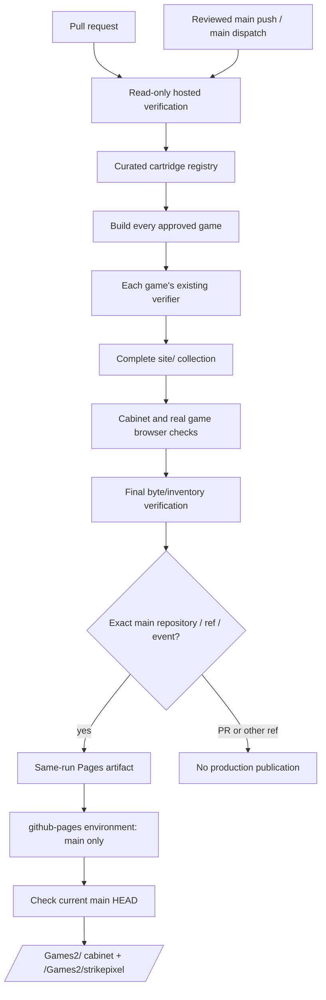

# G2-CABINET-001 audit and verification

This infrastructure PR starts from Games2 `main` at
`b47c7cf572fb474f3cb0abaf03eefa4ce7cf0908`, the merge commit for
[Strike Pixel PR #2](https://github.com/QSOLKCB/Games2/pull/2). The audit read the
root/game policies, current README/roadmaps, engine integration contract, complete
idea/donor inventories and Strike Pixel's existing build, verifier, worker and
browser suite. Its original [SP-001 evidence](../strikepixel/docs/VERIFICATION.md)
is preserved as historical evidence.

## Architecture and public inventory

The registry is a versioned, strict, data-only allowlist. It supplies titles,
descriptions, original art and status. The launcher derives local game URLs from
validated slugs. Concept/development rows never get a launch URL or a game package.
The initial collection contains one playable preview and two clearly identified
concept labels; no second game is implemented.

The site builder invokes each approved game's existing builder and verifier,
checks the complete package inventory and SHA-256 digests, and copies those bytes
without modification. It stages the complete collection before replacing `site/`.
A failing game build leaves the previous assembled site intact. Verification
rejects extra/missing files or directories, stale manifests and changed bytes.

```text
site/
  index.html
  cartridges.json
  LICENSE
  site-manifest.json
  cabinet/
    app.js
    registry.js
    style.css
    assets/{favicon,strikepixel,strikepixel-label,neon-apex,starward-signal}.svg
  docs/GAME_IDEAS.md
  strikepixel/
    index.html, start.js, style.css
    manifest.json, service-worker.js
    LICENSE, NOTICE, README.md, ROADMAP.md
    docs/{ARCHITECTURE,PROVENANCE,VERIFICATION}.md
    src/                         # Complete native game runtime
    vendor/vanillajs/             # Complete original selected engine closure
```

The exact per-file inventory is machine-readable in `site-manifest.json`; the
build output is ignored in Git. Tests, tooling, profiles, private files and raw
evidence are not published. The game's manifest and worker retain their original
package format. No engine metadata migration or replacement game builder was added.



## Executed local checks

The checked-in records under `evidence/cabinet-001/` identify the results and exact
site/game hashes. Commands were executed locally; workflow configuration is not
presented as proof that a hosted run or production deployment has occurred.

| Check | Result and scope |
| --- | --- |
| `node --test tests/*.test.mjs` | PASS: strict registry, multi-game retention, malicious/stale/missing package inputs, deployment guards and negative workflow mutations |
| `node --test strikepixel/tests/*.test.mjs` | PASS: all 24 existing game tests |
| `node scripts/verify-workflows.mjs` | PASS: pinned actions, explicit main guards, minimal permissions, verified artifact path and isolated deployment job |
| `node scripts/verify-site.mjs --source` | PASS: local source, artwork, module/resource paths and approved game entry points |
| Existing Strike Pixel source/build/package commands | PASS: reused without modification |
| `node scripts/build-site.mjs` and `node scripts/verify-site.mjs` | PASS: full approved collection and exact copied package bytes |
| Existing `node strikepixel/scripts/browser.mjs` | PASS: all 13 scenarios, including actual victory/defeat, device failures and offline startup |
| `node scripts/browser-site.mjs` | PASS: eight assembled-site scenarios at `/Games2/` |
| Protected source comparison and relative Markdown links | PASS; historical documents and engine/game evidence preserved |
| `git diff --check` | PASS |

Local runtime: Node **22.18.0**, external Playwright **1.64.0**, explicit headless
Chromium **158.0.8127.18**, software rendering. Hosted CI provisions the browser
bundled with the official Playwright pin; that is Chromium **156.0.8078.4**. These
are distinct execution environments. See [deployment documentation](DEPLOYMENT.md)
for official pin references and provisioning.

The cabinet browser suite actually selects cartridges with mouse, keyboard and
emulated touch, sees the original artwork and correct status, follows Play to the
real packaged game, starts a match, moves and fires. It checks return navigation,
browser history, direct entry, explicit worker activation and control, invalid
registry recovery, narrow 320px/390px layouts, reduced motion and missing-art
fallback. It then disables networking and starts/fires in a fresh game visit.

The worker scope is exactly the game's `/Games2/strikepixel/` directory. The
cabinet has no worker. A deliberately broken cabinet registry leaves the game
cache and an unrelated cache canary intact; the offline visit uses the installed
game after that cabinet failure. No broad cache deletion or worker takeover was
introduced.

## Negative publication tests

Tests parse the actual workflow files (JSON syntax, a YAML subset). They reject
unsafe changes to jobs, permissions, runner type, triggers, skipped gates,
checkout ref, action pins, artifact path, environment and verification dependency.
They simulate PRs, feature dispatches, wrong-case branch names, foreign repositories
and workflow-run events. The actual freshness shell is exercised with controlled
Git responses for current, stale and unavailable main HEADs.

Only reviewed `main` can upload the production artifact or enter the deployment
job. Its write/OIDC permissions are confined to that job. A PR does not deploy.
Workflow concurrency serializes the complete main build/deploy path. The live
main-HEAD check additionally rejects a superseded run. It is not an atomic lock
against a merge during an already-active deployment; the next queued main run
publishes after that run finishes.

## Review findings and limitations

The first complete cabinet browser pass succeeded. A subsequent readability pass
enlarged mobile content and navigation targets and improved retry focus. Independent
review also hardened combined default/named import detection, SVG stylesheet import
rejection, explicit worker activation waits and browser image-loading assertions.
These findings did not require changing gameplay or weakening existing assertions.
The workflow evaluator's initial diagnostic mismatch was fixed before its passing
negative tests; restricted-shell child-process reporting required running the
Node test runner with normal child-process access.

No physical controller, mobile device, GPU/RTX, screen-reader session, Firefox,
Safari or long-duration soak was executed. The cabinet is online navigation;
only installed individual games claim offline operation. Original concept artwork
is labelled as illustration rather than gameplay. The pre-existing gameplay and
immutable VANILLAJS v2.5.0 copies remain unchanged apart from optional cabinet
navigation and current-status documentation.

Pages settings were inspected read-only: Actions source, HTTPS enforced and a
`github-pages` environment limited to `main` are already configured. The public
root returned 404 before this work. No settings were changed, no production
workflow dispatched, and no PR code deployed. Expected post-merge URLs are:

- Cabinet: `https://qsolkcb.github.io/Games2/`
- Strike Pixel: `https://qsolkcb.github.io/Games2/strikepixel/`

After owner review and merge, verify the production workflow and actual live
navigation before marking deployment live or adding a verified live URL to the
game README. Neither a cabinet deployment nor SP-001's merge creates a game release.
