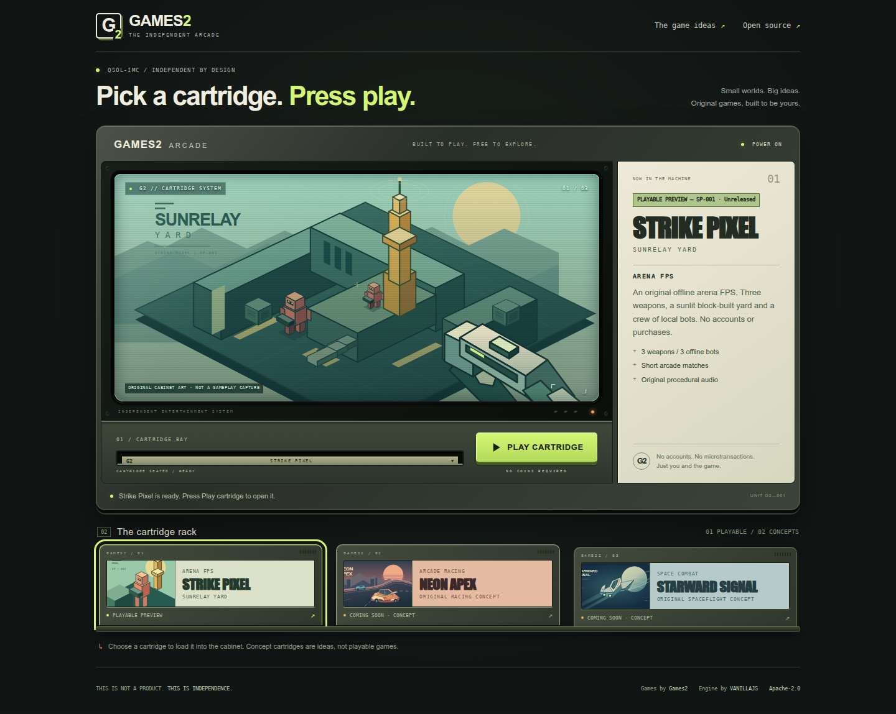

# Cartridge Cabinet execution evidence

See [the verification record](../../docs/CABINET_VERIFICATION.md) for commands,
source boundaries, test coverage and limitations. These records are excluded
from `site/`; the original `strikepixel/evidence/` remains unchanged.

- [Cabinet browser report](browser.json): eight final assembled-site flows passed, including actual gameplay and offline load, at the `/Games2/` prefix.
- [Cabinet output](cabinet-browser.log) and [initial successful pass](cabinet-first-pass.log), retained separately from the later readability/recovery pass.
- [Strike Pixel browser report](strikepixel-browser.json) and [output](strikepixel-browser.log): all 13 existing packaged game scenarios passed.
- [Strike Pixel Node record](strikepixel-node.tap): all 24 existing tests passed.
- [Root Node record](cabinet-node.tap): registry, collection retention and deployment-security tests.
- [Preservation record](preservation.json): 51 source/history files checked against the reviewed baseline.
- [Read-only Pages audit](pages-audit.json): Actions source and main-only environment already configured; public root initially 404.

The local browser was headless Chromium 158.0.8127.18 with software rendering.
Screenshots do not claim physical mobile, controller or GPU testing. No production
deployment was performed by this task.

[320px layout](cabinet-320.png) · [Actual launched game](launched-game.png) ·
[Missing-art fallback](missing-art.png).
