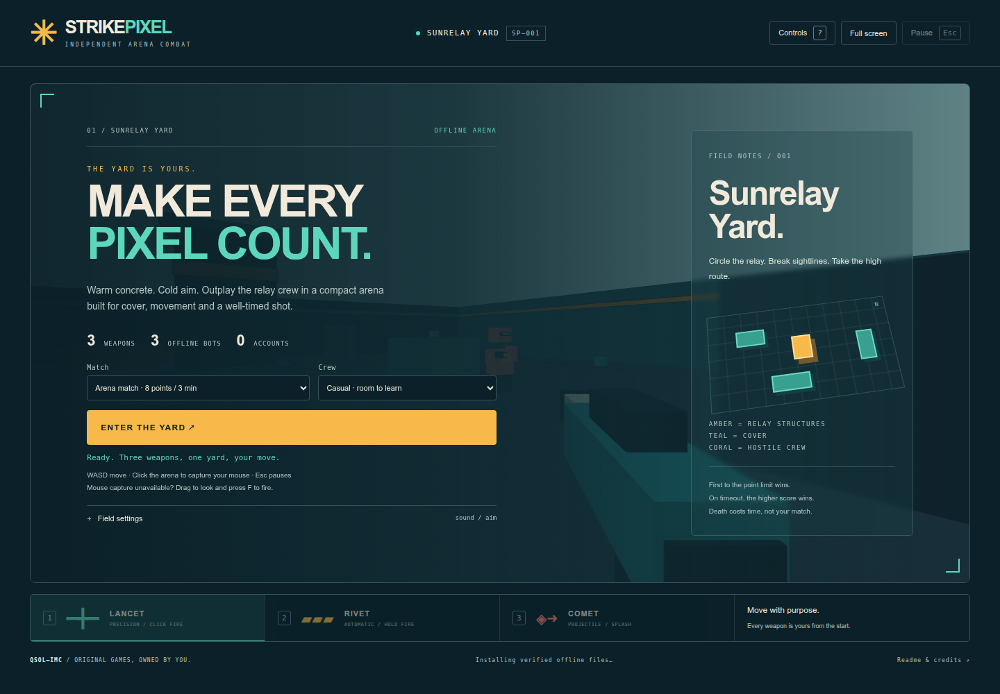
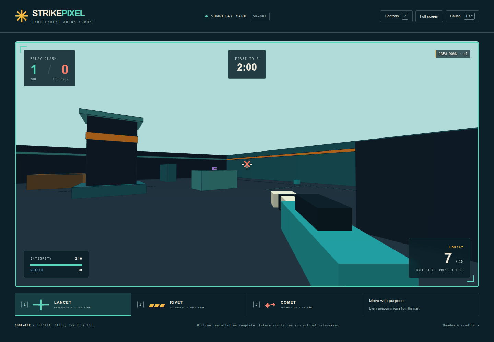
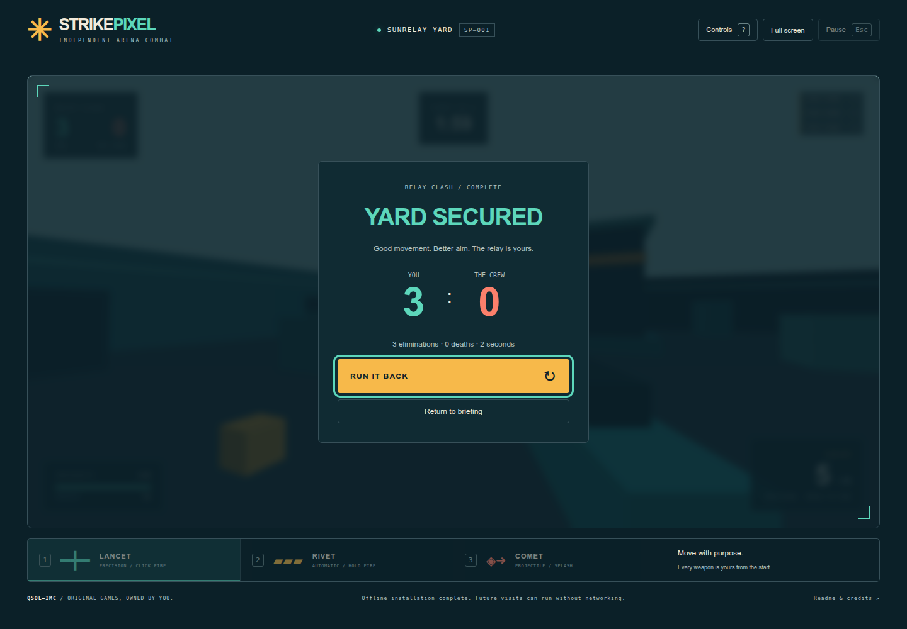
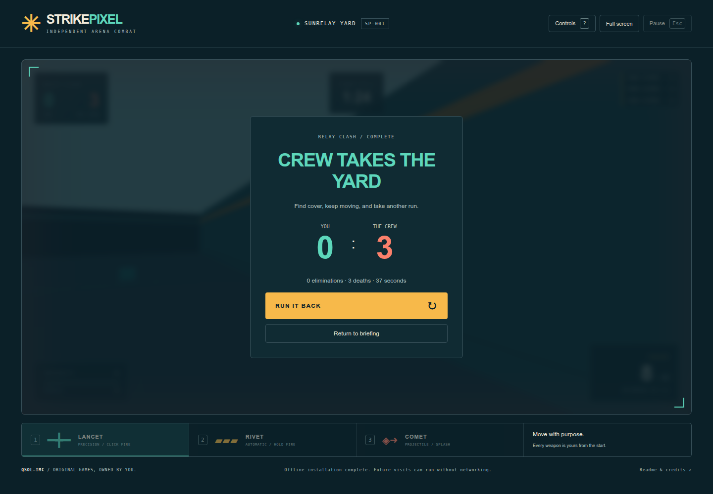

# SP-001 execution evidence

Recorded locally on 16 November 2026. The full context and limitations are in
[VERIFICATION.md](../docs/VERIFICATION.md). No files here are part of the playable
static package.

- [Node TAP record](node-tests.tap): 24 tests passed, none skipped.
- [Browser report](browser.json) and [console output](browser.log): 13 packaged Chromium scenarios passed in 41.667 seconds; exact package hash recorded.
- [Development attempts](browser-attempts.log): earlier failures and the first complete pass, retained without rewriting their outcomes.
- [Preservation audit](preservation.json): source pins, file digests and direct equality checks for the historical documents and engine closure.

Screenshots from the final run:

| Briefing | Actual combat |
| --- | --- |
|  |  |

| Victory | Defeat |
| --- | --- |
|  |  |

[320px layout](layout-320.png) · [390px layout](layout-390.png).
These are headless Chromium screenshots, not physical mobile-device evidence.
